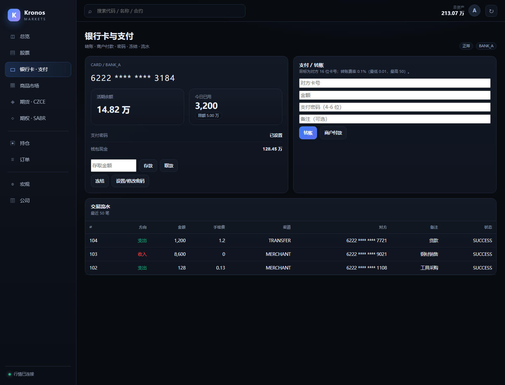

# 银行卡与支付系统

## 现有基础

- 16 位 Luhn 合法卡号，每玩家 1 张，确定性发卡；
- 发卡行 BANK_A..BANK_D；
- 银行卡与 A 股/CZCE/商品/公司 IPO 的“持卡门控”已存在；
- 银行存款/取款走 `Bank` 活期账户；
- 卡片数据随引擎 blob 持久化。

## 新增

### 卡片

- 4-6 位支付密码，SHA-256（卡号加盐）存储，不存明文；
- 冻结/解冻；
- 单日限额默认 50,000；
- 今日已用统计；
- 卡号 API 只返回 `6222 **** **** 3184`。

### 支付

- 卡对卡转账；
- 商户付款（`MERCHANT`）；
- 活期余额扣款；
- 跨行走付款行 `withdraw` + 收款行 `deposit`；
- 手续费 0.1%，最低 0.01，最高 50；商户付款免手续费；
- 手续费计入付款行 equity；
- 交易流水 append-only，最近 5,000 条随引擎 blob 持久化。

## 交易校验顺序

```text
玩家/卡片存在
→ 卡片 active
→ 未冻结
→ 已设置 PIN
→ PIN 哈希匹配
→ 收款卡有效且未冻结
→ 非本人卡
→ 单日限额
→ 活期余额（含手续费）
→ 银行清算（库存现金/准备金）
→ 扣款 + 入账 + 手续费 + 流水
```

任何一步失败都原子拒绝，不改状态。

## API

```text
GET  /api/bank/card                  当前卡信息（掩码）
POST /api/bank/card                  {bankId} 开卡
POST /api/bank/card/pin              {pin}
POST /api/bank/card/freeze
POST /api/bank/card/unfreeze
POST /api/bank/transfer              {toCard, amount, pin, memo}
POST /api/bank/pay                   {toCard, amount, pin, memo}
GET  /api/bank/statement?limit=50
GET  /api/bank/selftest              纯服务端自检（不碰 live 账户）
```

## 命令

```text
/bank issue <bankId>
/bank info
/bank pin <4-6位>
/bank freeze
/bank unfreeze
/bank transfer <toCard> <amount> <pin> [memo]
/bank pay <toCard> <amount> <pin> [memo]
/bank statement
```

## 前端

新增「银行卡 · 支付」页：

- 卡片视觉、掩码卡号、开户行、活期余额；
- 支付密码状态、冻结/解冻；
- 转账/商户付款表单；
- 最近 50 笔流水。



## 服务端自检

`GET /api/bank/selftest` 在独立 `BankManager/BankCardService/PaymentService` 中：

```text
开两张卡
设置 PIN
A 行存入 10,000
错误 PIN → 拒绝
正确 PIN 转账 1,000
手续费 1.00
付款方 8,999.00
收款方 1,000.00
流水 1 条
```

真实服务器结果：

```json
{
  "success": true,
  "wrongPinRejected": true,
  "transferSuccess": true,
  "fee": 1.0,
  "payerBalance": 8999.0,
  "payeeBalance": 1000.0,
  "ledgerSize": 1
}
```

## 验证

- `./gradlew compileJava`：**BUILD SUCCESSFUL**
- 真实 `runServer` + `/api/bank/selftest`：**success=true**
- 前端 mock 渲染：银行卡/支付/流水正常
- 最终 jar：`build/libs/financialmarket-1.0.0-full.jar`（22,855,244 bytes）。

## 边界

1. 支付在活期账户间完成，不直接扣钱包现金；需先存款。
2. 每日限额固定 50,000，未做按客户等级/风险动态调整。
3. 没有退款、撤销、争议、对账单下载、商户入驻/二维码。
4. 跨行没有真实 RTGS/净额清算，只做两家银行账本划转。
5. PIN 没有失败次数锁定；只有冻结开关。
6. 未做真实玩家在线双人转账 smoke；自检使用独立 UUID/独立银行实例。
