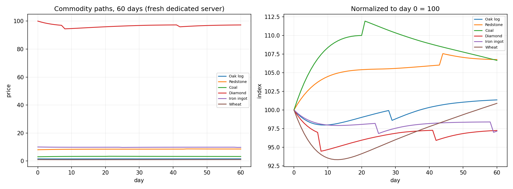

# 商品市场真实服务器 Smoke：自动定价 + 60 天路径

## 环境

- 专用服务器：NeoForge 21.1.119 / Minecraft 1.21.1，`runServer`
- 端口：`25566`（避开本机已有的 25565 服务器）
- 模组：Financial Market 1.0.0、MCEF、Minecraft、NeoForge
- 世界：新生成 `world`（无旧商品存档）
- HTTP：`http://localhost:8080`

## 真实 registry 结果

```text
GET /api/commodities
商品总数             1300
  物品               1298
  流体                  2
有限价格             1300 / 1300
成本下限违规            0
成本上限违规            0
60 天平均日波动         0.306%
60 天平均累计收益       0.557%
```

全部商品由 `CommodityRegistry.autoRegister` 自动注册，没有逐物品白名单。

初始锚点示例（与手工基准/配方一致）：

| 商品 | 初始价 |
|---|---:|
| Wheat | 1.00 |
| Redstone | 8.00 |
| Coal | 3.00 |
| Iron ingot | 10.00 |
| Diamond | 100.00 |
| Oak log | 1.50 |

> 开发环境只加载了原版 + 本模组，所以真实 registry 是 1,300 个商品，不是数万。真实整合包中同一段 `autoRegister` 会遍历整合包全部物品；数万规模另用合成压力测试覆盖。

## 数万规模压力测试

```text
合成商品             20,000
天数                    60
路径检查         1,200,000
非有限价格               0
成本下限违规             0
成本上限违规             0
最终平均波动          0.307%
```

20,000 × 60 = 1,200,000 次日频路径检查，无 NaN/Infinity、无越界。

## 60 天样本路径



CSV：[commodity_smoke_paths.csv](assets/commodity_smoke_paths.csv)

样本：

- Wheat：1.00 → 1.02，先跌后回升；
- Coal：3.00 → 3.18，能源季节性 + 动量；
- Redstone：8.00 → 8.49，趋势上行；
- Diamond：100 → 96，高位回落；
- Iron：10 → 9.90；
- Oak log：1.5 → 1.52。

路径不是直线，也不是每次跳价；有均值回归、动量、季节性与确定性冲击。

## 复现

```text
# 启动
.\gradlew.bat runServer

# 查询真实 registry
curl http://localhost:8080/api/commodities

# 60 天 smoke（真实 registry + 20k 合成）
curl "http://localhost:8080/api/commodity/smoke?days=60"
```

`runSmokeDays` 会保存当前商品 NBT，推进 60 天，收集样本路径，然后 **恢复原状态**；不会把 live 价格改掉。

## 本次修复

1. **引擎懒初始化**：HTTP 在无玩家登录时按世界创建引擎，否则 smoke 返回 503。
2. **初始定价顺序**：自动注册 → 手工基准覆盖 → 配方图刷新。
3. **只对 pristine 条目重定价**：不会把已有交易/存档价格重置。
4. **手工基准不再被配方刷新覆盖**。
5. **低价商品 4 位小数**：避免 0.5 元商品的价格图变成阶梯。

## 边界

1. 真实 registry 1,300，合成压力 20,000；后者验证模型规模，不验证 mod 物品命名/配方。
2. 60 天是引擎日频推进，不是现实 60 天 wall-clock。
3. 服务器运行在 25566，未做玩家登录/下单路径；本次只验证定价与路径。
4. 平均日波动 0.31% 偏低，符合当前保守参数；真实商品可再调高 `volatility` 初值/冲击系数。
