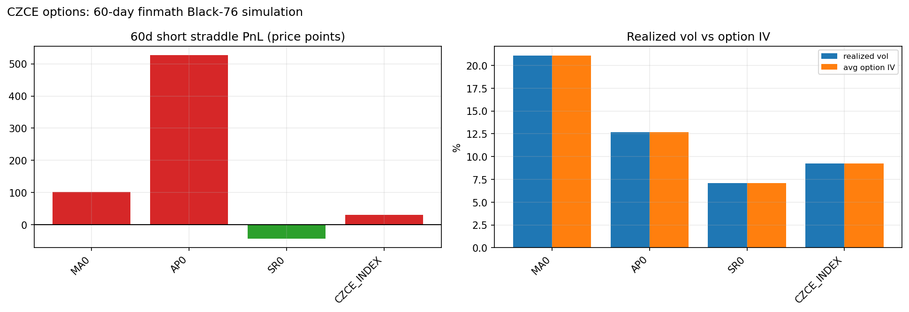
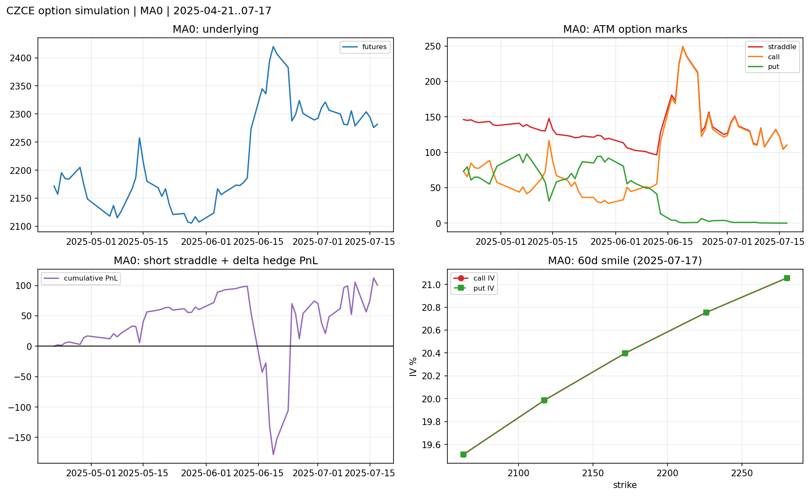
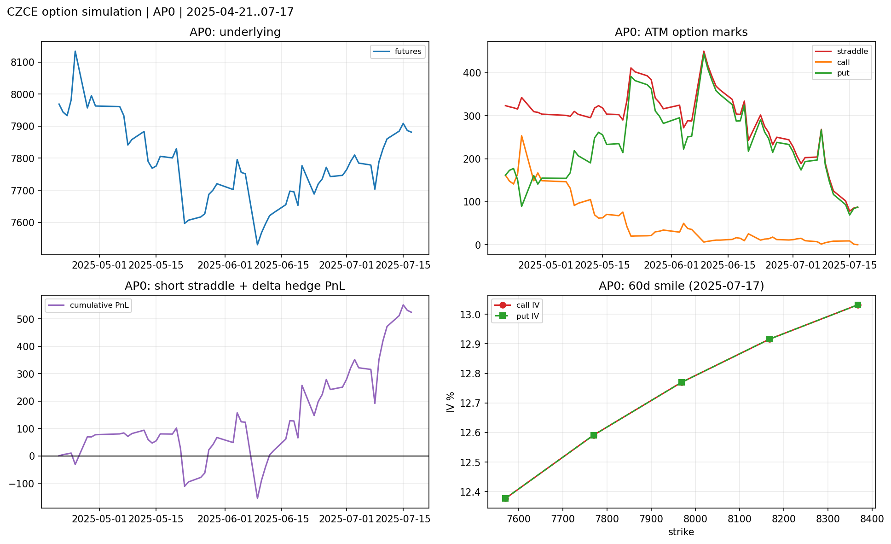

# CZCE 期权 60 天模拟（finmath-lib）

## 结果

- 使用 **finmath-lib 6.1.10** 的 Black-76 / Black-Scholes 解析公式。
- 标的：CZCE 甲醇 MA0、苹果 AP0、白糖 SR0、等权 CZCE 指数。
- 窗口：**2025-04-21 → 2025-07-17，60 个交易日**。
- 策略：卖出 1 单位 ATM call + 1 单位 ATM put（60 天跨式），每日用期货 delta 对冲；手续费 1bp。
- 数据：7,200 条期权链记录，240 条逐日策略记录。

| 标的 | 60d 实际波动 | 平均模型 IV | 跨式+对冲 PnL | 最大回撤 |
|---|---:|---:|---:|---:|
| MA0 | 21.06% | 21.10% | **+101.91** | −2.77 |
| AP0 | 12.70% | 12.68% | **+526.50** | −3.29 |
| SR0 | 7.11% | 7.11% | **−43.38** | −24.69 |
| CZCE_INDEX | 9.23% | 9.22% | **+29.90** | −2.50 |

> PnL 单位是**每 1 单位期权的价格点**，未乘合约乘数、未计手数和保证金占用；不是账户收益率。



## 甲醇 MA0



## 苹果 AP0



## 定价/希腊字母

对期货期权使用 Black-76：

```text
C = df · [F·N(d1) − K·N(d2)]
P = C − df·(F − K)
df = exp(−rT)
```

- `CzceOptionMarket.price(...)` 调用 `AnalyticFormulas.blackScholesGeneralizedOptionValue(forward, vol, T, strike, df)`。
- Delta/Gamma/Vega/Theta 调用 finmath 的 `blackScholesOptionDelta/Gamma/Vega`，Theta 用一天有限差分。
- 波动率曲面是**模型曲面**：`baseVol · (1 + 0.55x − 1.8x²)`，`x=log(K/F)`；不是从市场成交价反推的 IV。
- 因此表中的“IV”是**模型隐含波动率**，不是市场报价 IV。

## 数据

- 期权链：`.verify/options_2025/option_chain.csv`（7,201 行，含表头；7,200 条数据）
- 逐日策略：`.verify/options_2025/option_daily.csv`（241 行，含表头；240 条数据）
- 汇总：`.verify/options_2025/option_summary.csv`
- 图表：`.verify/options_2025/charts/`

字段：

```text
option_chain.csv:
date,asset,underlying,type,strike,expiry_days,price,iv,delta,gamma,vega,theta

option_daily.csv:
date,asset,underlying,call,put,straddle,iv_call,iv_put,delta,gamma,vega,theta,
hedge,equity,pnl,cum_pnl
```

## mod 接入

- 新增 `CzceOptionMarket`（`engine/futures/czce`）。
- 新增只读接口：

```text
GET /api/options?code=MA2505
```

返回当前 CZCE 合约的 30/60/90 天、5 档行权价期权链和 Greeks。

- 完整版 jar 内置：
  - `net.finmath` 类
  - `org.apache.commons.math3` 类
  - `META-INF/licenses/FINMATH-APACHE-2.0.txt`
  - `META-INF/licenses/COMMONS-MATH-APACHE-2.0.txt`
- 完整 jar：`build/libs/financialmarket-1.0.0-full.jar`（22,855,395 bytes）。

## 验证

- finmath 公式探针：100 远期、20% 波动、3 个月 call = **3.958**；IV 回算 **0.2000**。
- 完整 jar 内运行期权探针：call/put parity、Greeks、IV 正常。
- `./gradlew compileJava`：**BUILD SUCCESSFUL**。
- `./gradlew jar`：**BUILD SUCCESSFUL**。
- 完整 jar 内 `AnalyticFormulas.class`、`NormalDistribution.class`、`CzceOptionMarket.class` 均存在。

## 边界

1. 没有期权撮合/持仓/保证金账户；当前是定价、链和策略模拟，不是可交易的期权市场。
2. 没有从市场价反推 IV、没有校准真实波动率曲面；smile 是解析参数。
3. 只做了欧式期货期权；没有美式、亚式、障碍、组合保证金。
4. 60 天 PnL 未计合约乘数、手数、滑点、保证金资金成本和强平。
5. `/api/options` 只读，未接客户端 UI。

## 复跑

```powershell
$cp="third_party\finmath\finmath-lib-6.1.10.jar;third_party\finmath\commons-math3-3.6.1.jar"
javac -encoding UTF-8 -cp $cp -d .verify\world_macro_classes `
  src\main\java\com\example\financialmarket\engine\futures\czce\CzceOptionMarket.java `
  .verify\options_sim\CzceOptionSim.java
java -cp ".verify\world_macro_classes;$cp" CzceOptionSim .verify\options_2025
python .verify\options_sim\make_option_charts.py
```
