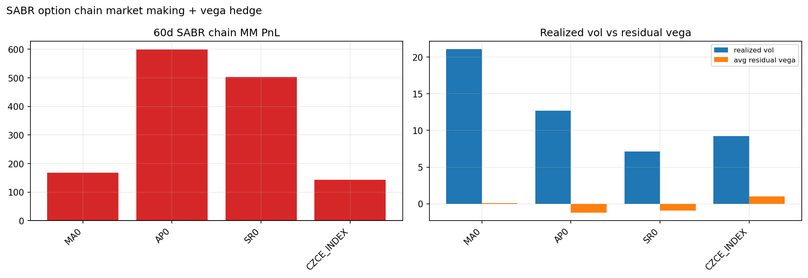
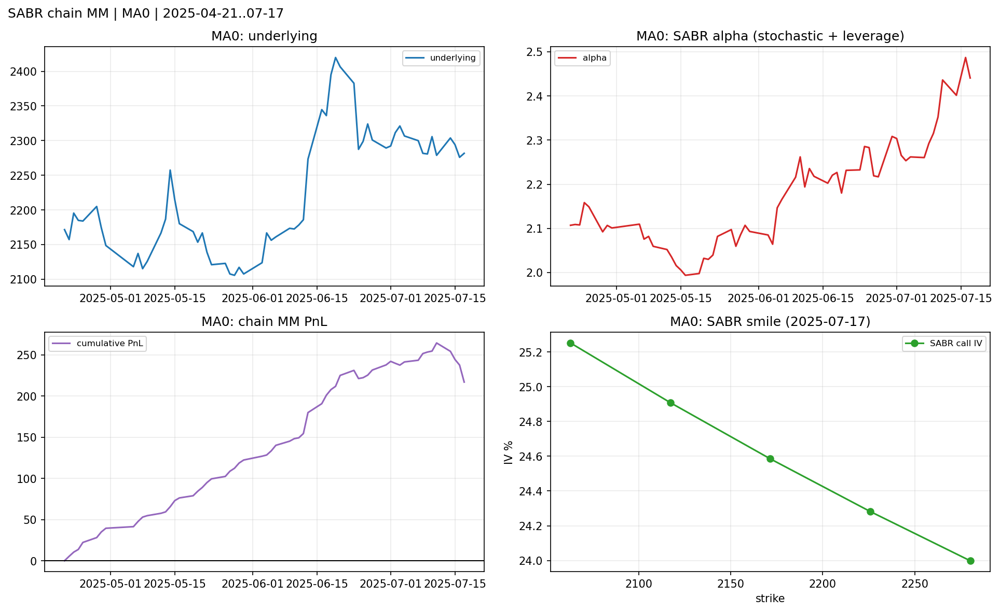
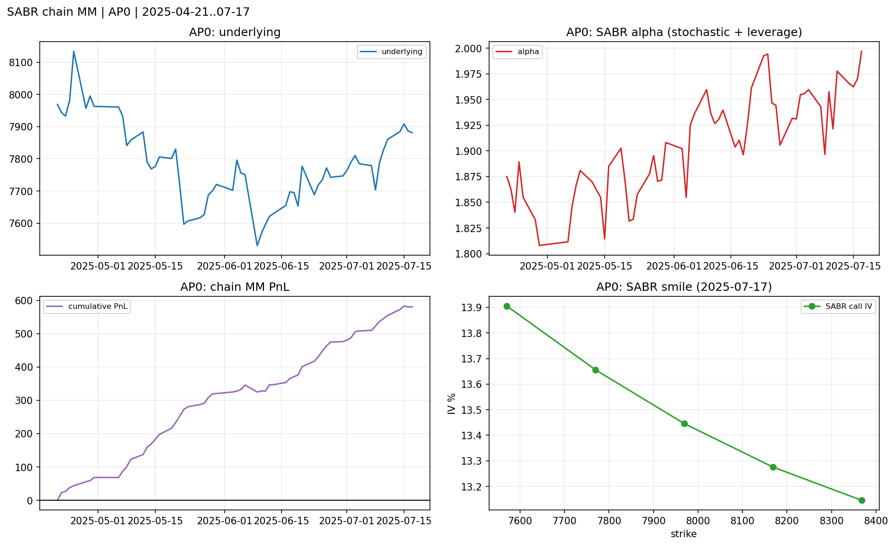

# SABR 期权链做市 + Vega 对冲（60 天）

## 结论

- 用 **SABR (Hagan 2002)** 替代原先的解析微笑，生成每个行权价的 IV；Black-76 只作为 **IV→价格** 的定价器保留（SABR 本身只给 IV，不给价格）。
- SABR 状态 `α, ρ, ν` 每日随机扰动，并注入杠杆效应：
  - 负收益 → 抬高 α、压低 ρ；
  - 实测 `corr(收益, Δρ)`：MA −0.751、AP −0.705、SR −0.536、指数 −0.342。
- 多行权价做市：5 档行权价 × call/put，60 天到期；随机客户流按 bid/ask 成交。
- 对冲：期货每日 delta 对冲 + ATM 60 天 call 做 vega 对冲（单位上限 ±20）。
- 60 天结果：四个标的全部正 PnL，但这是**做市价差+库存+对冲**的结果，不是方向性 alpha。



## 结果

| 标的 | 60d 实际波动 | 平均 α | 平均 ρ | 平均 ν | 最终 PnL | 最大回撤 | 平均残余 Vega |
|---|---:|---:|---:|---:|---:|---:|---:|
| MA0 | 21.06% | 2.178 | −0.319 | 0.465 | **+168.11** | −0.177 | +0.095 |
| AP0 | 12.70% | 1.903 | −0.260 | 0.487 | **+598.39** | −0.057 | −1.195 |
| SR0 | 7.11% | 1.033 | −0.269 | 0.500 | **+502.35** | −0.169 | −0.923 |
| CZCE_INDEX | 9.23% | 0.818 | −0.224 | 0.487 | **+143.14** | −0.012 | +1.017 |

> PnL/回撤单位是价格点/组合权益单位，未乘合约乘数、手数、保证金；不是账户收益率。

## 甲醇 MA0



## 苹果 AP0



## SABR 实现

```text
z = (ν/α)·(FK)^((1−β)/2)·ln(F/K)
x(z) = ln((√(1−2ρz+z²)+z−ρ)/(1−ρ))
σ(F,K) = α / [(FK)^((1−β)/2)·(1+((1−β)²/24)ln²(F/K)+…)] · z/x(z) · [1+correction·T]
```

- `β=0.7`；初始 `ρ=−0.3`、`ν=0.5`。
- `α` 由 ATM 目标波动率反解（二分 80 次）。
- 每日更新：
  - `α *= exp(0.22·√dt·ε − 4·r·√dt + meanRev)`
  - `ρ += 0.10·√dt·ε − 0.55·r`
  - `ν *= exp(0.18·√dt·ε)`
- 观测到的 α 范围：MA 1.99–2.49、AP 1.81–2.00、SR 0.96–1.12、指数 0.76–0.88。

## 做市/对冲

1. 5 档行权价（ATM ±2.5%、±5%）× call/put，60 天到期。
2. 报价：`mid ± (2%·mid + 0.4 + 库存偏斜)`。
3. 每日每个期权 30% 概率有客户流，按 bid/ask 成交 1 单位。
4. 期货 delta 对冲：`targetFutures = −(期权 delta + vega 对冲期权 delta)`。
5. Vega 对冲：ATM 60 天 call，`targetUnits = −netVega / atmVega`，上限 ±20。
6. 手续费 1bp。

## 数据

- 做市链：`.verify/options_sabr_2025/mm_chain.csv`（2,400 条 + 表头）
- 逐日组合：`.verify/options_sabr_2025/mm_daily.csv`（240 条 + 表头）
- 汇总：`.verify/options_sabr_2025/mm_summary.csv`
- 图：`.verify/options_sabr_2025/charts/`

字段：

```text
mm_chain.csv:
date,asset,type,strike,mid,bid,ask,iv,delta,gamma,vega,theta,inventory

mm_daily.csv:
date,asset,underlying,alpha,rho,nu,net_delta,net_vega,
futures_hedge,vega_hedge,equity,pnl,cum_pnl
```

## mod 接入

- 新增 `SabrModel`（`engine/futures/czce`）。
- 新增有状态 `CzceOptionDesk`：
  - 每个品种一份 SABR `α/ρ/ν`；
  - 每日按标的期货收益更新一次（杠杆效应）；
  - 参数与 `lastDay` 写入 `czceOptions` NBT；
  - `MarketEngine` 在 CZCE tick 里调用。
- `CzceOptionMarket.chainSabr(...)` 输出 SABR 期权链。
- `/api/options?code=MA2505` 从期权台读取当前 SABR 状态：
  - 30/60/90 天
  - 5 档行权价
  - call/put + Greeks
- `/fm option chain MA2505` 输出链。
- 完整版 jar 继续内置 finmath-lib + commons-math3。

## 验证

- SABR ATM 反解：目标 21% → 回算 21.0%。
- SABR 微笑：2300=22.0%、2500=21.0%、2700=20.3%（负偏）。
- `./gradlew compileJava`：**BUILD SUCCESSFUL**。
- 做市链 2,400 条、逐日 240 条，四个标的均有输出。
- 杠杆效应实测相关为负（见上表）。

## 边界

1. 做市是**随机客户流 + 报价成交**，没有真实订单簿、排队、逆向选择。
2. Vega 对冲被限制在 ±20 单位；残余 vega 仍存在（表内）。
3. 只有 60 天一个到期；没有期权到期滚动、组合保证金、行权/指派。
4. PnL 未乘合约乘数、未计手数、保证金、滑点、资金成本。
5. SABR 参数未做市场校准，只按 ATM 波动率锚定 + 随机演化；不是交易所真实 IV 曲面。
6. “替代 Black-76”指 **IV 模型替换**；Black-76 仍用于 IV→价格，这是标准做法。

## 复跑

```powershell
$cp="third_party\finmath\finmath-lib-6.1.10.jar;third_party\finmath\commons-math3-3.6.1.jar"
javac -encoding UTF-8 -cp $cp -d .verify\world_macro_classes `
  src\main\java\com\example\financialmarket\engine\futures\czce\CzceOptionMarket.java `
  src\main\java\com\example\financialmarket\engine\futures\czce\SabrModel.java `
  .verify\options_sim\CzceOptionMmSim.java
java -cp ".verify\world_macro_classes;$cp" CzceOptionMmSim .verify\options_sabr_2025
python .verify\options_sim\make_sabr_charts.py
```
