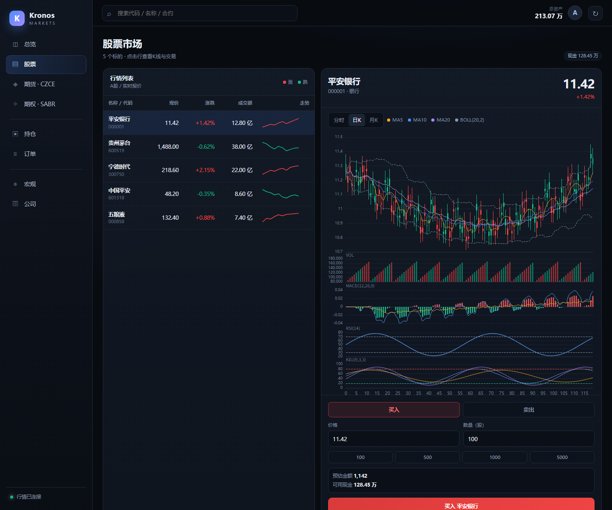

# 前端重写：Kronos Markets 交易终端

## 结构

- 新入口：`index.html`（单页应用）
- 样式：`app.css`
- 逻辑：`app.js`（原生 JS + ECharts，无构建步骤）
- 旧页面备份：`index_legacy.html`，可通过 `/legacy` 访问

## 页面

| 路由 | 功能 |
|---|---|
| `#/dashboard` | 总资产、持仓市值、指数、CZCE 权益、等权市场图、涨跌幅榜、期货快照、宏观 |
| `#/stocks` | 股票列表、走势、K线、买卖下单、快捷数量 |
| `#/futures` | CZCE 合约、涨跌停/保证金/持仓、做多/做空/开平仓、期货持仓 |
| `#/options` | 标的/到期切换、5 档行权价 Call/Put 链、SABR IV/Greeks |
| `#/portfolio` | 股票/期货持仓、账户汇总 |
| `#/orders` | 委托、撤单 |
| `#/macro` | 宏观/全球状态 |
| `#/companies` | 公司基本面 |

## 专业图表

股票详情页提供多面板技术分析（与研报图同结构）：

- 主图：K线 + MA5/10/20 + BOLL(20,2) 上中下轨
- 成交量
- MACD(12,26,9)：DIF/DEA + 红绿柱
- RSI(14)：70/30 参考线
- KDJ(9,3,3)：K/D/J + 80/20 参考线
- 分时 / 日K / 月K 切换
- 数据直接来自 `/api/kline` 的 `macdDif/macdDea/macdHist/rsi/kdjK/kdjD/kdjJ/bollUp/bollMid/bollLow`

## 设计

- 深色交易终端：侧边栏 + 顶栏 + 卡片化内容；移动端底部导航。
- A 股颜色约定：红涨、绿跌；期货涨跌停列同步修正。
- 数字使用 tabular-nums；空状态、toast、modal、响应式布局。
- 通过 `fetch` 只读/下单接口，9 秒自动刷新（输入框聚焦时暂停）。

## API

- 股票：`/api/stocks`、`/api/kline`、`/api/order`
- 账户/持仓：`/api/account`、`/api/positions`、`/api/futures/positions`
- 期货：`/api/futures`、`/api/futures/order`
- 期权：`/api/options?code=...`
- 其他：`/api/orders`、`/api/cancelOrder`、`/api/macro`、`/api/worldmacro`、`/api/companies`

## 视觉验证

- `node --check app.js`：**0 错误**
- 无头 Chrome + mock API 实际渲染：
  - Dashboard
  - Stocks
  - Options
  - Futures
  - Portfolio
  - Mobile 500px

截图：

- `.verify/frontend_dashboard2.png`
- `.verify/frontend_stocks2.png`
- `.verify/frontend_prochart_final.png`
- `.verify/frontend_options_final.png`
- `.verify/frontend_futures_final.png`
- `.verify/frontend_portfolio.png`
- `.verify/frontend_mobile500.png`

## 真实服务器 smoke

dev server 启动成功，H2/HTTP 8080 正常。真实后端（非 mock）检查：

- `/`、`/app.css`、`/app.js`、`/legacy`：**200**
- `/api/account`、`/api/stocks`、`/api/futures`、`/api/czce`、`/api/options`、
  `/api/companies`、`/api/macro`、`/api/worldmacro`、`/api/positions`、
  `/api/futures/positions`、`/api/orders`、`/api/index`：**全部 200 + JSON**

注意：

- 服务端绑定 loopback，Windows 下实际为 IPv6 `::1`；`http://localhost:8080` 和
  `http://[::1]:8080` 可用，`http://127.0.0.1:8080` 可能失败。
- 没有在线玩家时数据接口返回空集合，前端显示空状态；玩家进服后 9 秒轮询会填充。
- 下单/绑定玩家需要在线玩家，尚未做真实玩家点击 smoke。

## 边界

1. 期权页是**只读链**，没有期权下单/持仓（后端尚无期权账户接口）。
2. 期货页没有独立 K 线，显示合约/保证金/持仓/下单。
3. 旧页面只保留 `/legacy`，不保证与所有旧 JS 完全一致。
4. 前端依赖 `echarts.min.js`（已有静态资源）。
5. 未在真实 Minecraft HTTP 服务上跑浏览器 smoke；mock 服务器只验证静态布局/交互骨架。
